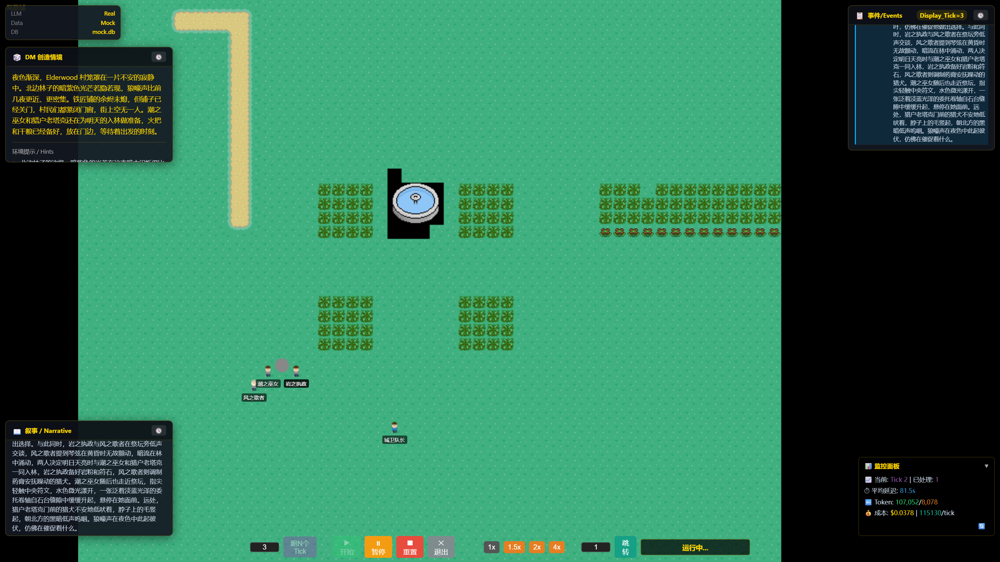
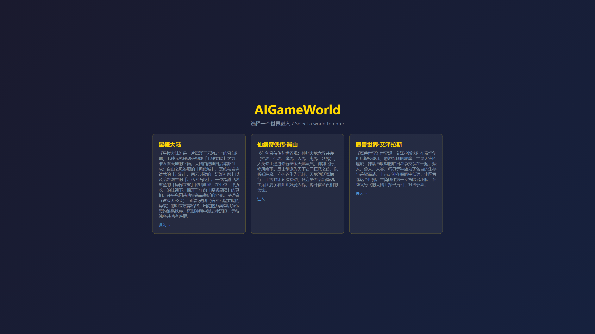
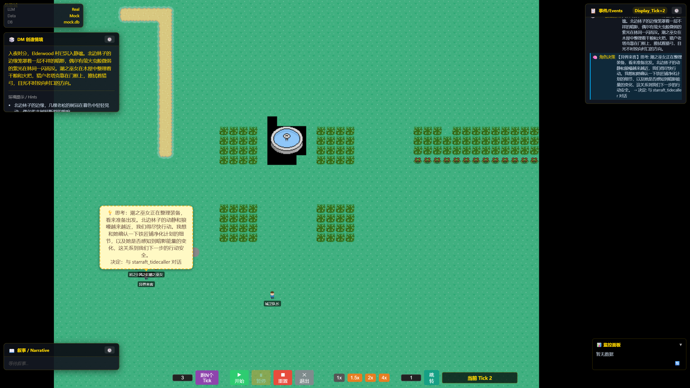
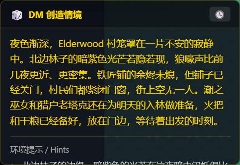
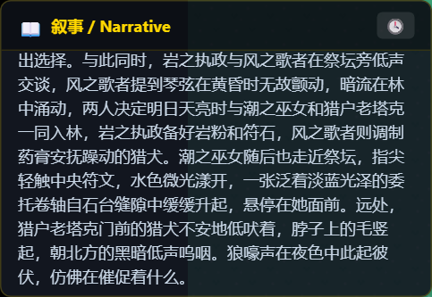
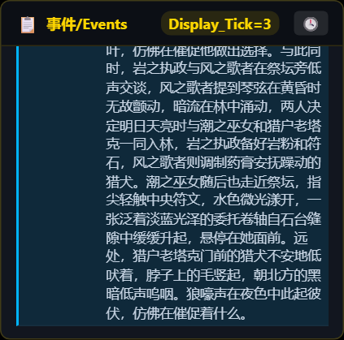

# AIGameWorld

> LLM 驱动的 Multi-Agent 游戏世界模拟引擎。DM Agent 创造情境，PC Agent 主角团自主决策，确定性规则引擎让行为产生真实后果。

基于 LangGraph 的 Multi-Agent 协作：DM（地下城主）与多个 PC（玩家角色）共享一个 DND 风格的虚拟世界，每个 Tick 自动驱动情境创建、角色决策、行动执行与叙事生成，前端 Phaser.js 实时渲染 2D 瓦片地图与动画。



## 界面速览

**① 世界选择入口** — 启动后访问前端，选择一个世界进入（星槎大陆 / 仙剑奇侠传·蜀山 / 魔兽世界·艾泽拉斯）：



**② 主界面** — 进入后直接渲染起始场景：左侧 DM 创造情境面板（情境简述 + 环境提示），右上事件流，PC 头顶出现「思考中」气泡表示决策进行中：



**③ 面板特写** — DM 情境 / DM 叙事 / 事件流三个面板随 Tick 持续更新：

| DM 创造情境 | DM 叙事 | 事件流 |
|---|---|---|
|  |  |  |

## 快速开始

### 环境要求

- Python 3.12+（推荐 [uv](https://github.com/astral-sh/uv) 管理）
- Node.js 20+
- LLM API Key（DeepSeek / GLM / Zen-Proxy 任选其一；**纯 Mock 模式无需 Key**）

### 1. 安装依赖

```bash
# 后端
cd backend
uv sync

# 前端（另开终端，或继续用同一终端）
cd frontend
npm install
```

### 2. 配置（可选）

```bash
cp .env.example .env   # 填入 LLM API Key；纯 Mock 模式可跳过
```

默认 `config.yaml` 即为 Mock 数据模式（`runtime.data_mode: mock`），启动时自动注入 tavern 数据集；LLM 默认走 `deepseek` 真实调用。

### 3. 启动后端（端口 8001）

```bash
cd backend
uv run python -m uvicorn src.server:app --host 0.0.0.0 --port 8001
```

验证：访问 http://localhost:8001/health 返回 `{"status":"ok"}` 即成功。
首次启动需加载 BGE-M3 嵌入模型并重建 ChromaDB 集合，约 15~60 秒。

### 4. 启动前端（端口 3000）

```bash
cd frontend
npm run dev   # http://localhost:3000
```

> 一键启动：项目根目录 `make dev`（先起后端、health 就绪后自动起前端）。

### 5. 选择世界进入

浏览器打开 http://localhost:3000 ，在世界选择页点击卡片进入（见上方「界面速览 ①」）。

### 6. 播放 Tick

用底部控制栏驱动世界：

| 控件 | 说明 |
|------|------|
| 数字输入 + 跑N个Tick | 单步批量执行 N 个 Tick |
| ▶ 开始 / ⏸ 暂停 / ⏯ 恢复 | 循环自动执行（默认间隔 2s），状态栏显示「循环中…」 |
| ⏹ 重置 / ✕ 退出 | 重置当前世界进度 / 退回世界选择页 |
| 1x ~ 4x | 回放倍速（控制前端事件动画播放速度） |
| 跳转 | 直接跳到指定 Tick |

每个 Tick 的流水线：DM 创造情境 → 角色决策（头顶气泡）→ 精灵移动/对话/交互/战斗动画 → DM 叙事 → 事件写入 DB。前端通过 HTTP 轮询拉取事件逐条回放，页面刷新后自动恢复进度。

### Mock 模式（无 API Key 也能跑）

`config.yaml` 中 `runtime.data_mode: "mock"` + `runtime.mock_dataset: "tavern"` 即可纯离线运行（数据 Mock、LLM 仍走配置的 Provider）；若连 LLM 也不调用，将 `runtime.llm_mock: true`，适合快速体验与开发调试。

### Docker（可选）

```bash
docker compose -f docker/docker-compose.dev.yml up --build
```

## 核心特性

- **LangGraph 状态图编排** — 8 节点顺序流水线：dm_create → load_data → tick_init → pc_subgraph → flush_events → dm_narrate → emit_narrative_event → persist_tick，3 个子图独立编译实现模块化拆分
- **Multi-Agent 协作** — DM Agent 负责情境创建与叙事生成，多个 PC Agent 各自运行决策-行动两阶段（decide → act），支持探索、对话、交互、战斗 4 种行动引擎
- **事件回放系统** — 后端 Tick 事件写入 DB，前端 HTTP 轮询拉取后按类型分发，驱动 Phaser.js 场景渲染与动画播放（地图切换、精灵移动、气泡对话、战斗特效），支持 1x~4x 倍速播放与页面刷新状态恢复
- **三层记忆架构** — 短期记忆（内存 deque，仅存不持久化）、长期记忆（ChromaDB 语义检索 + SQLite 补全，三要素精排）、反思记忆（LLM 生成高层次洞察，ChromaDB 独立集合），Scheduler 异步 Reflector 按定期/突发事件/累计阈值触发反思
- **多 Provider LLM 配置** — Provider/Purpose 分离的配置架构，支持 DeepSeek / GLM / Zen-Proxy 热切换，9 个 LLM Purpose 按温度与超时差异化配置，自动重试 + 模型降级 + Pydantic 结构化输出校验
- **Prompt 工程** — 全套 Jinja2 模板体系，动态注入世界观与场景上下文，统一语言约束；接入 Langfuse + LangSmith 实现 LLM 调用全链路追踪与成本核算
- **World Pack 系统** — YAML 驱动的世界包，支持世界观、角色、场景、物品、任务的声明式定义，启动时自动索引到 ChromaDB 知识库

## World Pack 系统

世界包位于 `world-pack/`（YAML 声明式定义世界观、角色、场景、物品、任务），后端启动时自动索引到 ChromaDB 知识库。新增自定义世界可用 [skills/world-builder](skills/world-builder/SKILL.md)：

```bash
python skills/world-builder/scripts/build_world.py --theme "蒸汽朋克" --name "蒸汽朋克·铜城"
```

## 辅助工具

```bash
# DB 查看器（浏览器查看 SQLite 数据，默认 9001 端口）
cd backend && uv run python scripts/start_viewer.py

# 重新生成 README 界面截图（需前后端已启动）
cd frontend && npm run docs:screens   # 输出到 docs/images/
```

## 项目结构

```
AIGameWorld/
├── backend/                  # Python 后端
│   ├── src/
│   │   ├── server.py             # FastAPI 入口
│   │   ├── orchestrator.py       # Tick 编排器
│   │   ├── config.py             # 配置加载器（YAML + Pydantic）
│   │   ├── graph/                # LangGraph 编排（主图 + 3 子图）
│   │   │   ├── graph.py              # 主 Tick 流水线
│   │   │   ├── state.py              # OverallState
│   │   │   └── subgraphs/            # load_data / tick_init / pc 子图
│   │   ├── engine/               # 行动引擎（7 个子引擎）
│   │   │   ├── dm/                   # DM 情境创建 + 叙事
│   │   │   ├── decision/             # PC/Actor 决策引擎
│   │   │   ├── talk/                 # 对话引擎
│   │   │   ├── explore/              # 探索引擎
│   │   │   ├── interact/              # 交互引擎
│   │   │   ├── combat/               # 战斗引擎
│   │   │   └── reflection/           # 反思引擎
│   │   ├── services/             # 服务层（7 个文件）
│   │   ├── repository/           # 数据访问层（11 个 Repo）
│   │   ├── storage/              # 存储层（ChromaDB + SQLite）
│   │   ├── domain/               # Pydantic 领域模型（14 个文件）
│   │   ├── prompts/              # Jinja2 Prompt 模板
│   │   ├── scheduler/            # 异步任务（Reflector 反思）
│   │   ├── llm/                  # LLM 客户端 + Mock
│   │   └── utils/                # 工具模块（日志/追踪/辅助）
│   ├── tests/                    # 34 个测试文件（300+ 用例）
│   └── data/                     # SQLite + ChromaDB 数据
├── frontend/                 # TypeScript 前端
│   ├── src/
│   │   ├── main.ts               # 入口文件
│   │   ├── bootstrap.ts          # 启动引导（健康检查 + 世界加载）
│   │   ├── TickPlayer.ts         # Tick 播放器（状态机 + 轮询 + 事件分发）
│   │   ├── scenes/               # Phaser 场景（Boot/GameScene）
│   │   ├── managers/             # 业务控制器（EventManager/MovementManager）
│   │   ├── ui/                   # DOM 面板（控制栏/事件/叙事/角色/Mock配置/指标）
│   │   ├── state/                # 状态管理（WorldStore/TickStore）
│   │   └── client/               # HTTP API 客户端
│   └── tests/e2e/                # Playwright E2E 测试
├── docs/images/              # README 截图（npm run docs:screens 生成）
├── world-pack/               # World Pack（世界观 YAML）
├── docker/                   # Docker 配置
├── config.yaml               # 主配置文件
└── Makefile                  # 顶层命令
```

## 记忆系统

### 架构

```
┌──────────┬──────────────────┬─────────────────┐
│ 短期记忆  │ 长期记忆          │ 反思记忆         │
│ deque    │ ChromaDB + SQLite │ ChromaDB 独立集  │
│ 内存窗口  │ 语义检索 + 补全    │ LLM 抽象洞察     │
└──────────┴──────────────────┴─────────────────┘
```

### 检索策略

- **短期记忆**：deque 窗口全量注入，按 tick 倒序
- **反思记忆**：ChromaDB 语义检索全量注入，前置
- **长期记忆**：ChromaDB 语义召回（top_k×3）→ SQLite 补全字段 → 三要素精排取 top_k

### 三要素评分

`Score = Relevance(语义相似度) + Recency(指数时间衰减) + Importance(1-10归一化)`

### 重要性映射

| 记忆类型 | importance |
|----------|-----------|
| reflection | 10 |
| combat | 8 |
| interact | 4 |
| talk | 3 |
| explore | 2 |
| observation | 1 |

### 反思触发

- **周期触发**：每 50 tick
- **突发事件**：最新记忆 importance ≥ 8
- **累计触发**：SQLite SUM(importance) ≥ 100

## 测试

```bash
# 后端（300+ 用例）
cd backend && uv run pytest

# 前端 E2E（38 用例，自动启动后端 mock 环境）
cd frontend && npx playwright test
```

## 配置

`config.yaml` 关键配置项：

| 配置 | 默认值 | 说明 |
|------|--------|------|
| `server.port` | 8001 | 后端 API 端口 |
| `runtime.data_mode` | mock | 数据模式：mock / real |
| `runtime.llm_mock` | false | LLM 是否返回 Mock 数据 |
| `runtime.db_name` | data/dev.db | 真实数据 SQLite 路径 |
| `runtime.mock_db_name` | data/mock.db | Mock 数据 SQLite 路径 |
| `runtime.mock_dataset` | tavern | Mock 数据集名 |
| `llm_provider` | deepseek | LLM 提供商（deepseek / glm / zen-proxy） |
| `database.chroma_path` | data/chroma/ | ChromaDB 持久化路径 |
| `database.embedding_model` | bge-m3 | 嵌入模型 |
| `auto_run.default_interval` | 2000 | 循环 Tick 间隔（毫秒） |
| `auto_run.reflection_interval` | 5 | 反思间隔（tick） |

## 技术栈

**后端**：Python 3.12 / FastAPI / LangGraph / LangChain / ChromaDB 1.5 / SQLite / Pydantic / uv（Neo4j 可选，缺失时 GraphRAG 关系网络优雅降级，不影响主流程）

**前端**：TypeScript / Phaser 3 / Vite / Playwright

**LLM**：DeepSeek / GLM / Zen-Proxy（可切换）

**可观测性**：Langfuse / LangSmith

**工程化**：GitHub Actions CI / ruff / pyright / eslint / prettier / pytest / vitest

## License

MIT
